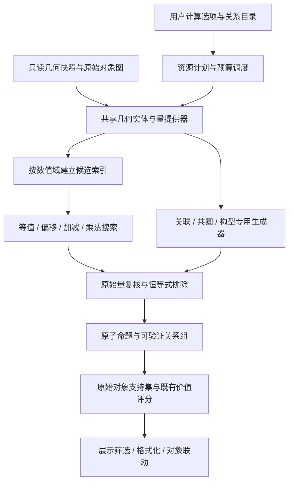

# 关系发现：几何量、数值域与代数搜索架构

状态：整体架构目标；2026-10-19 首批实现与后续调整见 [生成关系空间](./generator-spaces.md)。配套 [实施计划与关系目录](./relation-discovery-plan.md)、[UI 规格](./relation-discovery-ui.md)。本文件中的 TypeScript 与目录仍是概念草图，不能据此认为所有阶段已完成。

当前主路线已升级为“先建带来源的低复杂度生成约束，再约化角／log 量的搜索”；相似／全等提前，面积下沉到向量叉乘，切触以后按圆幂／极线视角接入。完整整数 lattice、LLL 和时间轮转调度仍是后续工作。

## 1. 层次与依赖方向



算法不依赖 React、DOM 或 GeoGebra 实例。主线程负责只读快照和 UI；runner 接收可序列化数据。Worker 与同步分块 runner 执行同一纯计算任务，前者不是第二套 detector。

新类型应能复用已有资源。例如点对仅计算一次，长度、方向、普通角、平行、垂直共同消费；关闭某种输出不删除别的类型需要的共享资源。

## 2. 实体身份：先保留对象，再做几何聚合

区分四种概念：

| 概念 | 示例／用途 |
| --- | --- |
| 原始对象引用 | 真实存在的 P、Q、命名 l、c；用于依赖评分和原生选中 |
| 几何位置／支撑实体 | 近重合位置、两点支撑直线、三点候选圆；用于减少数值重复与退化 |
| 几何量 | AB 的长度、∠ABC 的值；保留有角色的实体参数 |
| 表达式／命题 | L(AB)/L(CD)=L(EF)/L(GH)；由量引用组成，不复制几何对象 |

当前 `preparePoints` 会先把重合点压成代表，这对现有检测有用，却会丢失新“点重合”类型最需要的身份。因此新 scene 应保留原始对象表，在聚合前输出重合见证，再建立位置代表；每个代表记录全部来源，不能只保留第一个名字。

**数值近重合不等于恒等别名。** X=A 可以按已有评分的纯引用规则折叠；两个独立构造点数值重合则应作为关系保留。某对象只因近重合而被替代，不应让其原始依赖来源永久消失。

隐式直线、圆、角、辅助交点只是计算实体，不能创建 GeoGebra 临时对象，也不能作为“新作图步骤”插入依赖图。既有 `buildDependencyProfile` 继续只读真实对象图。

### 2.1 稳定引用与角色

- 无向线段端点按对象引用规范化，AB 与 BA 为同一长度量。
- 射线保留起点／经过点；普通角可交换两条射线，有向角按数值域规则处理。
- 有向面积保留顶点排列奇偶性；无向面积才取绝对值。
- 关系 ID 用域、运算、角色化量引用和规范化系数组成，不使用桶编号、浮点值或并查集根下标。
- 首版引用只需在文档 epoch／快照内稳定；改名在完整无截断样本中应产生等价的重命名结果，不承诺跨文件持久 ID。

## 3. 数值域与代数能力

共性应建立在**域的数学结构**上，不是把所有值都变成一个 `number` 后共用比较函数。

| 域 | 值与意义 | 能力 |
| --- | --- | --- |
| `point-position-2d` | 归一化的二维仿射位置 | 距离、邻桶、等值；不自动暴露位置加法 |
| `direction-mod-pi` | 无向支撑线方向，R/πZ | 周期距离、加减／固定偏移 |
| `length` | 非负长度 L，量纲 L¹ | 标量比较；提升到 R 做加减；非零部分可乘除 |
| `squared-length` | L²，量纲 L² | 标量比较与加减；不冒充长度 |
| `unsigned-angle` | 射线普通角 [0,π] | 标量比较；提升到 R 做和／倍数；不自动取模 |
| `directed-angle-mod-pi` | 有向直线角，R/πZ | 周期比较和群运算 |
| `unsigned-area` | 非负面积，量纲 L² | 标量比较／加法；非零部分可乘除 |
| `oriented-area` | 有符号面积，量纲 L² | 实数加法；非零部分映到符号×log 群 |
| `displacement-2d`（后续） | B−A 等向量 | R² 加法，保持平移不变性 |

仿射位置本身不是不依赖原点的向量群。若扩展 P+Q=R+S 等仿射关系，应使用位移或要求位置线性组合系数和为零；不能盲目搜索 x/y 坐标的任意和式。

默认只搜索欧氏几何中的内在关系，不搜索依赖坐标轴的偶然常数。绝对方向 θ 会随整体旋转平移一个角度，因此其线性关系要求方向生成元系数和为零；“两线夹角为 45°”可以搜索，“某线方向为 45°”不属于默认类型。相同原则排除任意绝对长度／面积常数，保留单位变换下不变的等值、倍数与齐次组合。

### 3.1 最小能力接口

```ts
// 概念接口；算法只要求自己需要的能力。
interface MetricDomain<V> {
  id: DomainId;
  candidateIndex(policy: TolerancePolicy): CandidateIndex<V>;
  compare(a: V, b: V, context: ErrorContext): ResidualResult;
}

interface AdditiveDomain<V> extends MetricDomain<V> {
  zero: V;
  add(a: V, b: V): V;
  negate(a: V): V;
  scaleInteger(a: V, coefficient: number): V;
  torsionFree: boolean;
}

interface MultiplicativeEmbedding<V, A> {
  additiveDomain: AdditiveDomain<A>;
  encodeNonzero(value: V): A | InvalidQuantity;
  verifyOriginal(expression: ProductExpression<V>): ResidualResult;
}
```

索引只产生可能匹配的 ID，真正是否近似成立由 `compare`／原值 verifier 判定。维度、周期、符号和容差由 domain／provider 提供，不能由通用搜索器猜测。

没有需求时不实现某个能力，不预先引入泛型群论框架、运行时 DSL 或插件动态加载。首批只需二维位置、普通标量、周期标量及几个小搜索算子。

### 3.2 量与表达式携带什么

每个量包含：稳定键、域、数值、物理维度、角色化来源、原始对象支持集、有效／未定义／病态状态、局部误差估计，以及可选的形式生成式。表达式用判别联合 AST 保存量引用、整数系数、和／差／积／商／目标常数，禁止用字符串 `eval`。

长度归一化为 L/scale，面积为 S/scale²；值可共享坐标帧，但维度仍保留。只允许维度一致的加减与两边量纲相等的乘除式。角度即使在物理上无量纲，也属于独立语义域，不能与长度比直接相等。

同域直接比较可有高效实现：等长可用平方距离避免开方；长度和必须使用长度值。若用 log(L²) 搜索长度比 k，目标偏移必须为 2log(k)，不能误用 log(k)。这些优化放在 adapter，不污染结果的几何含义。

## 4. 通用近似匹配内核

### 4.1 候选索引

- 实标量：排序窗口或定宽分桶；量值误差随尺度变化时分层／多分辨率索引。
- 二维／低维值：空间桶及邻桶；圆参数等各维容差不同，先按容差缩放坐标。
- 周期标量：周期邻桶或复制边界窗口；查询覆盖距离上界内的全部桶。
- 若周期被分成 N 格，实际格宽为 period/N；邻格数按实际格宽与误差半径推导，不能默认永远只查 ±1 格。

量的归一化、候选检索和最终残差采用一致的误差政策。不能在桶中用一种尺度，在复核中用另一种尺度，再把漏检藏在“近似”里。

### 4.2 近似相等不是等价关系

a=0、b=0.75ε、c=1.5ε 时，a≈b、b≈c，却不能输出 a≈b≈c。现有并查集可以保留用于候选连通分量，但不能直接把该分量当作全体相等的结论。

建议通用内核输出**已验证的匹配边／见证**，分组层再构造容差直径受控的组：

1. 标量可用窗口端点约束，周期量用最短覆盖弧及边界复核。
2. 多维域用距离上界证书快速接纳；不能证明全组直径满足阈值时做必要的成对复核。
3. 大密集组受预算限制时，保留明确验证的星形见证，显示“这些量均接近代表量”；不得格式化成声称所有成员成对相等的无条件链。
4. 覆盖不了的有效边可保留为额外见证／重叠小组，不需要求解最优团覆盖；截断必须计入诊断。

所有显示的命题都能回到原始量独立复核。把两个候选量放入同一索引桶，不等于登记一条可继续当作精确前提使用的事实。

## 5. 固定偏移、线性与乘法关系

### 5.1 固定偏移／已知倍数

在加法域中，给定有限常数集 C，查询 x≈y+c。垂直就是方向相差 π/2；正长度 x≈k·y 经 log 得到 log(x)≈log(y)+log(k)，复用同一个固定偏移引擎。

常数必须来自类型的有限配置，不根据任意一对数“计算出一个常数”后将其当发现，否则任何两段长度都存在一个比例，毫无筛选意义。

### 5.2 小整数线性组合

从三项模式 x+y≈z、x−y≈z 开始：枚举一侧二项表达式，查询基础量索引，避免三重全扫描。四项模式 x+y≈z+w 则建立二项和索引，再做近似等值匹配。

同样引擎可用于长度和、平方长度和、普通角和、周期角和、有向面积和。每类声明系数集、最大项数、允许共享参数的规则与候选预算。不得使用“参数不能共享”这种全局规则：等腰底角、中位线等有意义关系本来就共享顶点。

周期群有额外边界：2α≡2β mod π **不能**直接约分成 α≡β mod π，还允许相差 π/2。仅在无挠群的实数线性方程中，才按公因数约系数；模群需保留整系数／相应周期信息，不做不合法的除法。

普通角 α+β=π 与有向角 α+β≡0 mod π 是不同命题，不能用后者直接格式化成“互补”。

### 5.3 乘积、商和等比例

正实数乘法群通过 log 映入实数加法群：

```text
x/y≈u/v  ⇔ log(x)−log(y)≈log(u)−log(v)
xy≈uv    ⇔ log(x)+log(y)≈log(u)+log(v)
```

候选阶段复用二项和／差索引。最终在原始量上验证 xy≈uv 或 xv≈uy，采用缩放后的安全乘积及误差上界，必要时仍在 log 域比较幅度，以免溢出；不是直接相乘后接受 Infinity 或 NaN。

负量不能直接 log。非零有向量采用 `(signBit, log(abs(x)))`：乘法对应 Z₂×R 的加法，符号必须匹配。零量不属于乘法群，只能进入等值／加法算法；分母接近零或误差区间跨零时跳过比例并给出病态计数。

量纲检验先于搜索／发布。对 Σcᵢlog(qᵢ)≈constant，要求相应物理维度指数 Σcᵢdim(qᵢ)=0；仅在显式声明的同量纲模板中混合面积与长度乘积。

不将共享的数值分组当精确等值替换后继续推导。每条候选都从原始几何量重算残差，防止误差通过代数链放大。

## 6. 专用生成器也使用公共协议

以下类型不必为了“通用化”强行展开成大量加减式：

- **直线与圆重合**：直线参数先将法向量归一化，比较 `(a,b,c)` 与另一组参数的正／负两个代表；不能仅凭一个近零系数的符号选唯一分支而漏检边界。圆比较圆心与半径，分别使用位置与长度误差。
- **共点**：对不近似平行的线对求有限交点，使用二维近似匹配提出多线候选，再检查交点到每条线的距离。重合线不计作额外的不同直线；当前不输出无穷远共点。
- **切触**：线圆用 `|distance(center,line)−r|`；两圆分别用外切 `|d−(r₁+r₂)|` 和内切 `|d−|r₁−r₂||`。先排除半径退化及重合圆，否则同一圆会被误报为内切。
- **相似／全等三角形**：每个非退化三角形生成规范化边长描述子，索引相同形状；保留排序边到顶点的置换。复核最多六种对应，镜像和等腰／等边对称多解可聚合显示，不能丢掉对应关系。全等再校验尺度一致，不通过任意成对遍历全部三角形完成。
- **中点／角平分线等可读标签**：在近似等长／等角及关联候选资源中匹配有限角色模板，再从原值复核。这些资源可以按需建立，不要求“等长／等角输出”同时开启。模板不调用自定义工具、不创建作图、不因为输入函数名相似而宣称关系成立。

这些生成器都输出同一 `RelationClaim`，服从相同预算、退化诊断与支持集映射。几何专用算法和代数内核共享基础数值资源，不共享未经复核的“精确事实”。

## 7. 恒等式、重复关系与搜索信号

通用搜索会发现大量永真式。以下是基础量表达方式的恒等式消除，不是解读 custom 工具语义。

- **代数规范化**：同类项抵消、两侧换位、无向线段反向、相同比例与倒数换位、x/x=1 等不重复输出；对模群只用合法变换。
- **方向生成式**：θ(l₂)−θ(l₁) 记录为基础方向生成元的稀疏形式。因此 ∠(l₁,l₂)+∠(l₂,l₃)=∠(l₁,l₃) 的系数可完全抵消，应过滤。
- **有向面积生成式**：[ABC]=(A∧B+B∧C+C∧A)/2，以形式点对楔积为生成元，可过滤普遍三角剖分线性恒等式。普通角的分支不能照搬方向生成式。
- **关联恒等式**：由 Line(A,B) 表示的隐式线含 A、B 属于表示本身，不枚举为新发现；任意 M=f(A,B) 是否在 AB 上仍交由数值观测及依赖评分，不能凭函数名删除。
- **组合复杂度限制**：有限系数、有限项数、限定模板和最小有效支持，才是真正控制搜索空间的办法。不要指望事后全部排序解决表达式爆炸。

不实现通用定理重写器；不会仅因共圆就自动证明一批等角后加入事实库。不同类型数值上重述相同构型时，先建立可折叠的“关联观测”，保留用户类型控制，避免跨类型去重误删探索信号。

## 8. 关系定义、结果与评分

建议每个注册定义包含：稳定 `kind`、分组／标签／符号、输入资源、domain、算子或专用生成器、候选约束、对称规范化、原值复核、原始对象支持映射、展示格式与默认成本档。元数据保持纯数据；算法函数由代码注册，不写进 Worker 消息或浏览器存储。

例如“长度相等”与“角度相等”均绑定等值算子，只更换 provider、domain、参数角色和 formatter；“垂直”绑定方向域和 π/2 偏移；“长度二倍”绑定长度的 log 嵌入和 log(2) 偏移。新类型不复制一套分桶、容差分组、任务取消和 UI 勾选框。

结果分为三层：

```text
RelationClaim    一个具体、独立复核过的命题，含角色、表达式和原始支持
RelationFamily   同类命题的显示聚合，含分组语义、全部成员与有限见证
DiscoveryResult  快照版本、各类型状态／预算诊断、family 列表
```

证据保存：归一化残差、接受阈值、退化／条件质量、单构型数值状态。残差越小不自动代表数学上越难，也不把残差换算成概率百分比。旧 `confidence` 在迁移时只保留兼容来源，不强行跨不同新域比较它的大小。

评分继续使用当前统一依赖局部性函数。每个量／表达式回溯真实来源：AB 的长度映射到 A、B；∠ABC 映射到 A、B、C；命名 l 的角关系映射到实际 l。拟合圆／虚拟交点只回溯真实定义支持，不发明作图顶点。与展示不同，评分不能只取截断后的八个见证。

阶段 A 保持原组评分；新增组也按其明确的完整支持集评分，类型不加人为价值加成。未来按关键子命题优化分组评分属于独立变更，需与当前瓶颈跨度的已知取舍一起回归，不在重构中悄悄切换。

## 9. 计划、预算、缓存与取消

`buildDiscoveryPlan` 将开启的输出类型展开为资源 DAG，合并重复 provider；输出类型和底层资源是两个集合。view 过滤器不进入计算计划。

建议最小运行键：文档 epoch、几何快照 revision、依赖图 revision、类型／domain／容差版本、计算范围和预算配置。定义改变但坐标未变时，几何缓存可能可复用，依赖评分必须重算；未知事件保守失效。显示筛选变化只跑 view selector。

每个任务在固定操作批次检查取消令牌和截止时间。纯 runner 采用迭代器／分块任务；Worker 通过 requestId、cancel 消息管理本地取消令牌，不能假定可将 AbortSignal 或回调函数直接 structured-clone。主线程只接纳当前 requestId／revision 的结果。

预算分开记录：基础量数、组合表达式数、候选比较数、复核数、结果组数、见证数及时间。族间轮转分配时间，不能让共圆或四项组合饿死基本等长／等角。显示“结果前 200 条”不等于只生成前 200 条，更不能声称它们是全局最高分。

首版无需细粒度增量算法：先正确全量失效与快照缓存。确认性能瓶颈后，再根据量的支持集局部失效。归一化尺度变化时尤其不能只刷新单个点的派生量。

## 10. 建议目录与迁移边界

```text
analysis/
  geometryRelations.ts                 # 旧入口，逐步委托给 runner
  geometryTypes.ts                     # 公共协议与兼容类型
  scene/                               # 身份、归一化、点对、线／圆／三元组资源
  quantities/                          # 量定义、domain、长度／角度／面积 provider
  algebra/                             # 近似索引、偏移、线性搜索、乘法嵌入、表达式规范化
  relations/                           # 目录与关系定义、原检测器 adapters、有限构型模板
  pipeline/                            # plan、runner、budget、版本与 Worker 协议
  presentation/                        # family builder、格式化、supports 到评分的映射
  preferences/                         # 发现设置的 defaults／normalize／store
  docs/
components/relations/                  # 控件、类型表、列表与评分徽章
```

这是职责图，不要求预先创建大量空目录或为每个字段建文件。首批可合并小模块。现有 `equivalence.ts` 的并查集和周期距离可复用，但其簇语义和邻桶覆盖必须按上述约定复核。原有 `constructionSource`／图／评分保持稳定边界；新的命名直线与圆数据源在阶段 D 接入，而非让 detector 调用 GeoGebra。

新增常规类型的理想改动范围：一个 provider 或既有 provider 配置、一个注册定义、相应数值／构型测试。调度器、控制面板和主结果列表不需要随类型数量增长而逐项追加 switch。
