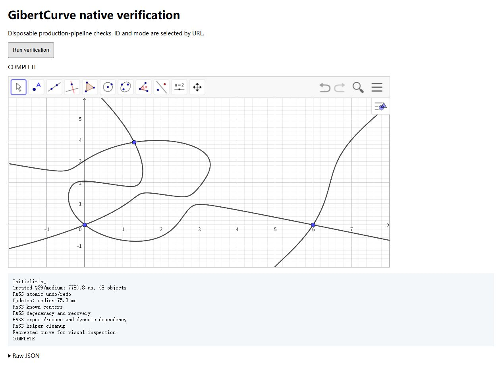

# GibertCurve 首批接入：原生验收（P3）

2026-10-29。覆盖 Q002、Q003、Q012、Q033、Q039。对应 [接入记录](../related-curves-roadmap.md) 与 [数据维护说明](../../data/related-curves/README.md)。完整采样见 [JSON](gibert-curves-integration.json)。

## 实现与复现

在仓库根运行 `npm run dev -- --host 127.0.0.1`，打开
`/scripts/geogebra/browser/geogebra-gibert-smoke.html?id=12&mode=high`，点击 Run verification。
可选 medium；`history=1` 检查整次撤销／重做，`quoted=1` 用字符串 ID，
`keep=1` 在清理验收后重新创建一条曲线供观察。实验使用正式 executeCommandPipeline，
没有单独维护另一套曲线 builder。

生成器先离线展开笛卡尔单项式系数，运行时借用现有 bind / named execution
创建隐藏数值中间量。原生引擎只计算这些标量并绘制最终 ImplicitCurve，
不在含 x/y 的表达式里反复进行重心代入和符号展开。没有坐标快照、更新回调或宏。

Medium 和 High 对这批纯数值绑定生成相同的构造。Low 匿名 Q012 的探索超时，
因此正式接口声明 requiresNamed：Low、无法安全降低的作用域或混合调用、已有输出
标签的重定义，均在原生求值前报错，不回落到匿名式。

另外试过将标准三角形的隐式曲线通过原生 ApplyMatrix 映射至 ABC，但本次引擎
输出为 undefined，已放弃该后端。P0 probe 的 `variant=matrix` 保留为复现入口。
这些失败候选未接入生产库。

## 性能样本

Windows / 内嵌 Chromium 156，实际 GeoGebra 版本 5.4.920.0。
初始化后创建 A=(0,0)、B=(6,0)、C=(1,4)，坐标范围设置为 [-2,8]×[-2,6]。
每条记录一次创建、八次移动 C；无 warmup，创建包含当前需要的命令模块加载与
辅助对象设置。更新计时到 setCoords 返回，不含后续方程／点检查，不等于连续手拖帧率。
单次样本不据此建立统计稳定的 p95 或跨设备保证。

| 曲线 | 模式 | 创建 | 更新中位数 | 数值辅助对象 |
| --- | --- | ---: | ---: | ---: |
| Q002 | High | 832 ms | 7.9 ms | 39 |
| Q003 | High | 1331 ms | 14.6 ms | 42 |
| Q012 | Medium | 1803 ms | 20.8 ms | 44 |
| Q033 | High | 976 ms | 10.7 ms | 36 |
| Q039 | High | 4501 ms | 41.5 ms | 64 |
| Q039 | Medium、字符串 ID | 7781 ms | 75.2 ms | 64 |

Q039/High 的浏览器 viewport 是 560×567，其余成功记录为 1280×720；实际参数均保留
在 JSON。这两次 Q039 不构成 Medium 与 High 的速度对照，二者生成的数字依赖相同。
相比 P0 每次约 0.7–1.3 秒的直接式更新，新后端说明“预先生成数值系数”有实际价值，
但没有用不同视口、冷启动或系统负载下的数据宣称精确提升百分比。

创建成本仍然明显，Q039 约 4.5–7.8 秒。它适合明确选择后创建、随后动态拖动；
不能以快速更新宣称创建已经流畅，也不批量创建整个目录。后续优化重点是创建解析、
数值辅助数量、文件成本，以及真实主页面的自动保存和分析刷新。

## 正确性和生命周期

全部五条均通过：

- 原生 XML implicit 类和非零多项式控制；输出仅一条曲线，辅助量按现有机制隐藏并标 auxiliary。
- C 的八次移动后，曲线保持定义，方程随输入变化。
- 数据库列出的有限可用中心残差检查；Q033 另检查三个边中点与三个反中三角形顶点。
- 共线、重复顶点时 undefined，移回一般位置后恢复；正三角形特化保留非零可约／降次式。
- `.ggb` 导出、重开、再次移动 C；无需站点更新回调。
- 删除诊断函数和输出后，经现有生命周期协调器清除未被引用的辅助组。

Q033 和字符串形式 Q039 另通过原子撤销／重做：一次 undo 同时移除正式输出与辅助量，
redo 恢复曲线。Q039 的 Medium 样本实际执行 `GibertCurve(A,B,C,"Q039")`。

Q033 测试最初把 X(30)、X(370) 都当作必定可用的有限点，原生分别为 undefined，
这两次诊断也保留在 JSON。X(30) 是 [Euler 无穷远点](https://faculty.evansville.edu/ck6/encyclopedia/part1.html)，
已单独分类；X(370) 记录为当前配置不可用的条件点，未猜测是超出编号、公式缺失还是
实数域条件。X(5456) 另列为超出本次原生支持范围的点，不拿静态坐标代替动态中心。

单元测试还以独立的五个重心定义，对一般、镜像、相似变换三角形的多个离曲线样本
核对生成笛卡尔方程；检查字面量来源穿过 compose、文件工具优先、Low 拒绝、
同名输出拒绝且不发生构造变更。生成器检查主式与已录入另一表达式的比例关系，
包括 Q039 的 [TXT 展开式](http://bernard-gibert.fr/curves/Resources/Q039.txt)。

完整页面的长时间连续拖动、多曲线共存、移动设备、极大平移与近共线数值稳定性
仍需后续补测；不在本次结果中声称已覆盖。

下图为清理验收后重新创建的 Q039 与完成记录，截图不参与计时。

